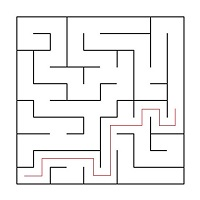
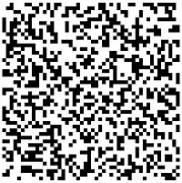

# 🧩 Maze & Cave Generator & Solver

[](https://www.oracle.com/java/)
[](https://gradle.org/)
[](https://junit.org/junit5/)
[](https://www.formdev.com/flatlaf/)

Десктопное приложение на **Java 17** для процедурной генерации идеальных лабиринтов и пещерных систем, а также нахождения кратчайших путей с визуализацией. Разработано в архитектуре **MVC** с современным графическим интерфейсом на базе **Swing** и темы **FlatLaf**.

---

## 📸 Интерфейс приложения

| Генерация и решение лабиринта | Клеточный автомат пещер |
| :---: | :---: |
|  |  |

---

## 🛠 Стек технологий

* **Язык**: Java 17
* **Сборка**: Gradle (Kotlin DSL: `build.gradle.kts`) + Gradle Wrapper
* **GUI**: Java Swing + [FlatLaf](https://www.formdev.com/flatlaf/) (современный Look and Feel)
* **Тестирование**: JUnit 5 (Jupiter), JUnit Platform
* **Вспомогательные инструменты**: Project Lombok

---

## 🚀 Ключевые возможности

### 1. Генерация и решение лабиринтов
* **Алгоритм Эллера (Eller's algorithm)**: пошаговая построчная генерация «идеального» лабиринта (отсутствие замкнутых циклов, существование ровно одного пути между любыми двумя точками). Сложность алгоритма по времени: $O(N \cdot M)$.
* **Поиск кратчайшего пути (Pathfinding)**: нахождение оптимального маршрута от точки старта до финиша с помощью алгоритма поиска в ширину (**BFS**).
* **Кастомные размеры**: поддержка лабиринтов произвольной размерности от $1 \times 1$ до $50 \times 50$.

### 2. Генерация пещер (Клеточный автомат)
* **Симуляция жизни/смерти (Cellular Automaton)**: моделирование естественных пещерных структур на основе алгоритма клеточных автоматов.
* **Гибкая настройка правил**:
  * Предел «рождения» клетки (`lifeLimit`).
  * Предел «смерти» клетки (`deathLimit`).
  * Начальная вероятность заполнения клетки (`lifeProbability`).
* **Режимы генерации**: как пошаговая смена поколений по клику, так и автоматическая непрерывная эволюция с настраиваемой задержкой таймера.

### 3. Импорт и экспорт
* Сохранение сгенерированных лабиринтов и пещер в текстовом формате.
* Загрузка и валидация внешних файлов конфигурации с защитой от повреждённых данных.

---

## 🏛 Архитектура проекта

Проект спроектирован с соблюдением принципов чистой архитектуры и паттерна **MVC**:

```text
src/
├── main/java/
│   ├── domain/               # Доменные модели и чистая алгоритмическая логика
│   │   ├── algorithm/
│   │   │   ├── generator/    # Алгоритм Эллера и клеточные автоматы
│   │   │   └── pathfind/     # Поиск пути в графе (BFS)
│   │   └── model/            # Неизменяемые структуры данных (Maze, Cave, Matrix, Position)
│   ├── filemanager/          # Парсинг, валидация и сериализация карт в файлы
│   ├── gui/                  # Слой графического интерфейса
│   │   ├── maze/             # Панели, канвас отрисовки и контроллер лабиринтов
│   │   ├── cave/             # Панели, канвас отрисовки и контроллер пещер
│   │   └── MainFrame.java    # Корневой контейнер с переключением вкладок
│   └── main/                 # Точка входа (Main.java)
└── test/java/                # Комплексные модульные тесты
```

---

## ⚙️ Сборка и запуск

### Требования
* **JDK 17** или выше.
* Наличие установленного Gradle **не требуется** (в репозиторий включен `gradlew`).

### Быстрый запуск приложения

```bash
# 1. Клонирование репозитория
git clone https://github.com/your-username/maze-generator-and-solver.git
cd maze-generator-and-solver

# 2. Запуск приложения через Gradle Wrapper
./gradlew run
```

### Сборка исполняемого Fat JAR

```bash
# Сборка JAR со всеми зависимостями
./gradlew jar

# Запуск собранного JAR-файла
java -jar build/libs/maze-generator-and-solver-1.0.0.jar
```

---

## 🧪 Тестирование

Бизнес-логика покрыта модульными тестами с использованием **JUnit 5**:
* `MazeGeneratorTest`: валидация граничных размеров ($1 \times 1$, $50 \times 50$), выброс исключений при некорректных аргументах, проверка связности и отсутствия изолированных областей.
* `CaveGeneratorTest`: проверка переходов состояний клеточного автомата в зависимости от соседей.
* `MazePathFindingTest`: корректность поиска кратчайшего пути и обработка тупиковых маршрутов.
* `MazeFileManagerTest`: тестирование сохранения и загрузки с верификацией матриц.

Запуск тестов:
```bash
./gradlew test
```
